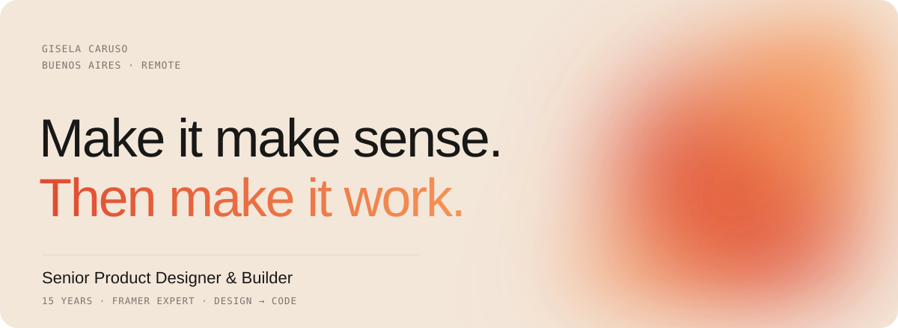
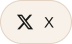
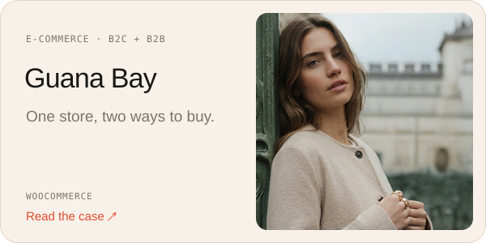
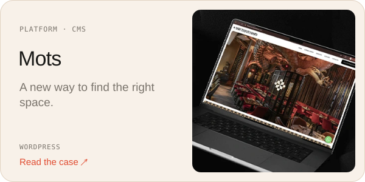
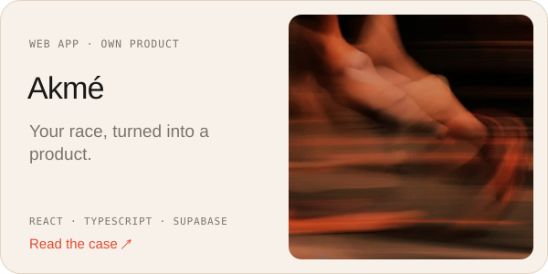
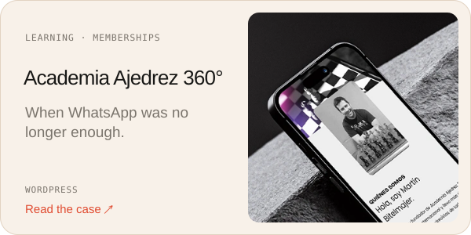
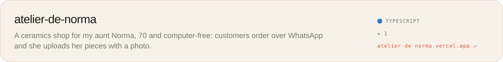
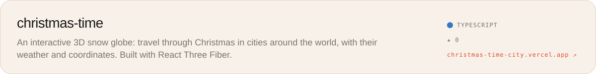
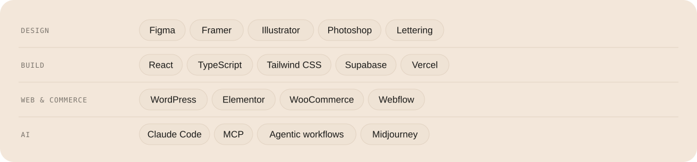
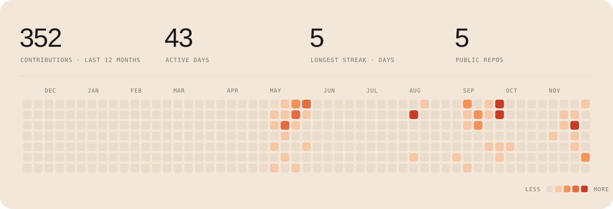

<picture>
  <source media="(prefers-color-scheme: dark)" srcset="https://raw.githubusercontent.com/giselacaruso/giselacaruso/main/assets/hero-dark.svg">
  
</picture>

  <a href="https://www.giselacaruso.com"><picture><source media="(prefers-color-scheme: dark)" srcset="https://raw.githubusercontent.com/giselacaruso/giselacaruso/main/assets/social/web-dark.svg"></picture></a>
  <a href="https://www.linkedin.com/in/gisela-caruso/"><picture><source media="(prefers-color-scheme: dark)" srcset="https://raw.githubusercontent.com/giselacaruso/giselacaruso/main/assets/social/linkedin-dark.svg"></picture></a>
  <a href="https://www.framer.com/@gisela-caruso/"><picture><source media="(prefers-color-scheme: dark)" srcset="https://raw.githubusercontent.com/giselacaruso/giselacaruso/main/assets/social/framer-dark.svg"></picture></a>
  <a href="https://contra.com/giselacaruso"><picture><source media="(prefers-color-scheme: dark)" srcset="https://raw.githubusercontent.com/giselacaruso/giselacaruso/main/assets/social/contra-dark.svg"></picture></a>
  <a href="https://x.com/giselacaruso"><picture><source media="(prefers-color-scheme: dark)" srcset="https://raw.githubusercontent.com/giselacaruso/giselacaruso/main/assets/social/x-dark.svg"></picture></a>
  <a href="https://www.instagram.com/gisela.caruso"><picture><source media="(prefers-color-scheme: dark)" srcset="https://raw.githubusercontent.com/giselacaruso/giselacaruso/main/assets/social/instagram-dark.svg"></picture></a>
  <a href="mailto:info@giselacaruso.com"><picture><source media="(prefers-color-scheme: dark)" srcset="https://raw.githubusercontent.com/giselacaruso/giselacaruso/main/assets/social/email-dark.svg"></picture></a>

I'm a product designer and builder from Buenos Aires, Argentina. I've spent 15 years in branding, digital design and the web, and I've learned that good products show up when strategy, design, technology and execution work together.

Today I work with founders and product teams end to end: shaping the problem, designing the experience and building the thing, in [Framer](https://www.framer.com/@gisela-caruso/), WordPress or code. I'm growing toward **design engineering**, using AI to get from idea to working product faster without giving up design judgment.

### Selected work

Case studies from [giselacaruso.com](https://www.giselacaruso.com).

  <a href="https://www.giselacaruso.com/casos/guana-bay-en.html"><picture><source media="(prefers-color-scheme: dark)" srcset="https://raw.githubusercontent.com/giselacaruso/giselacaruso/main/assets/cases/guanabay-dark.svg"></picture></a>
  <a href="https://www.giselacaruso.com/casos/mots-en.html"><picture><source media="(prefers-color-scheme: dark)" srcset="https://raw.githubusercontent.com/giselacaruso/giselacaruso/main/assets/cases/mots-dark.svg"></picture></a>
  <a href="https://www.giselacaruso.com/casos/akme-en.html"><picture><source media="(prefers-color-scheme: dark)" srcset="https://raw.githubusercontent.com/giselacaruso/giselacaruso/main/assets/cases/akme-dark.svg"></picture></a>
  <a href="https://www.giselacaruso.com/casos/academia-ajedrez-360-en.html"><picture><source media="(prefers-color-scheme: dark)" srcset="https://raw.githubusercontent.com/giselacaruso/giselacaruso/main/assets/cases/academia-dark.svg"></picture></a>

### Built for fun

  <a href="https://github.com/giselacaruso/atelier-de-norma"><picture><source media="(prefers-color-scheme: dark)" srcset="https://raw.githubusercontent.com/giselacaruso/giselacaruso/output/repo-atelier-de-norma-dark.svg"></picture></a>
   
  <a href="https://github.com/giselacaruso/christmas-time"><picture><source media="(prefers-color-scheme: dark)" srcset="https://raw.githubusercontent.com/giselacaruso/giselacaruso/output/repo-christmas-time-dark.svg"></picture></a>

### Toolkit

<picture>
  <source media="(prefers-color-scheme: dark)" srcset="https://raw.githubusercontent.com/giselacaruso/giselacaruso/main/assets/stack-dark.svg">
  
</picture>

### Activity

<picture>
  <source media="(prefers-color-scheme: dark)" srcset="https://raw.githubusercontent.com/giselacaruso/giselacaruso/output/activity-dark.svg">
  
</picture>

<b>My path so far</b>

 

| Year | Milestone |
| --- | --- |
| 2006 | My typeface *Special Type* is selected at the 2nd Tipos Latinos Latin American Typography Biennial |
| 2008 | Graphic designer at Estudio Avant |
| 2009 | Graduated in Graphic Design at UBA and started working independently |
| 2010 | Senior graphic designer at Estudio Garfunkel |
| 2012 | Finalist at *Conectados*, Fernet Branca's national art and design contest |
| 2016 | Co-founded Equipo Latina, where I'm creative and digital director |
| 2018 | Founded Flicka Lettering: brand activations and workshops for 150+ students |
| 2025 | Certified Framer Expert. Featured in NocodeHackers' *El altavoz* |
| 2026 | Shipping my own products with React, TypeScript and AI, on the way to design engineering |

Stats refresh daily with GitHub Actions. Every image here is generated by <a href="scripts/generate.py">scripts/generate.py</a>.

